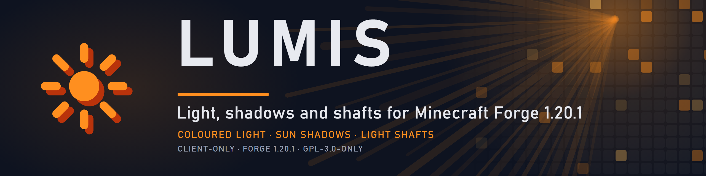
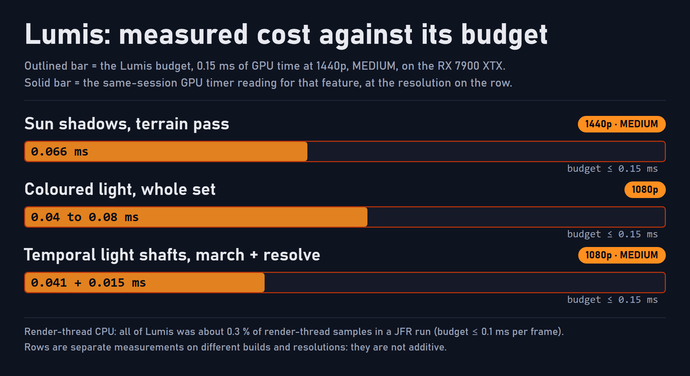

<p align="center">
  
</p>

# Lumis

Lumis is the light mod of the [Atmosphera](https://github.com/SolarBiscuit/Atmosphera) suite for Minecraft 1.20.1 on Forge. It gives the game coloured light, sun shadows and volumetric light shafts **without a shaderpack**: no second geometry pass, no shadow map and no G-buffer, so it runs on the same hardware the game already runs on.

> **Client-only.** Lumis is never required on a server and never blocks joining one. It needs [AtmospheraLib](https://github.com/SolarBiscuit/AtmospheraLib), and it steps aside when a shaderpack replaces the terrain shaders.

## Features

This is the feature set Lumis will have when its [roadmap](#roadmap) is complete. Items marked † are research items: each ends in a written go/no-go and ships only if it passes.

### Coloured light

- **Coloured lightmap.** Warm block light with a per-dimension Kelvin colour, and a time-of-day sky tint. Dimension profiles live in `config/Atmosphera/lumis-dimensions.json` (the Nether is warm and sunless, the End is cool and sunless).
- **Per-emitter colour.** Every light source has its own hue, held in a 3D volume around the camera. Light does not colour through walls, and neighbouring lights blend smoothly instead of meeting at a seam.
- **Far colour.** A coarse second volume colours terrain between the near volume and the render distance, on Embeddium-based renderers and on NeoVoxy LODs.
- **Held and dropped lights.** Lantern and torch colour follows the player's hands and dropped items, through CheapLighting's dynamic light sources.
- **Tinted entities and particles.** Mobs, armour and first-person arms take the colour of the light they stand in, on Embeddium's fast vertex path†, and particles are tinted from the same data†.
- **Resource-pack colours.** `assets/lumis/light_colors/*.json` overrides the built-in colour rules, and a dump command shows where each colour came from.

### Sun and shadows

- **Sun-directed shading.** Terrain, entities and distant LODs are shaded by their angle to the sun, and by the moon at night.
- **Heightfield sun shadows.** A horizon map gives soft, accurate shadows from terrain, trees and buildings, plus entity shadows. It rebuilds only when the sun, the window or the terrain changes.
- **LOD shadows.** A coarse second cascade extends the shadows over NeoVoxy LODs.
- **The sun you see.** Shadows, shafts and glints follow the sun a skybox actually draws (Nuit Forged), not only the vanilla sun angle.
- **Sun through windows†.** A one-bit-per-block occupancy volume lets beams pass through windows and roof gaps.
- **Leaf dapple† and stained-glass tint†.** Moving sun flecks under canopies, and beams and shadows that take the colour of stained glass.

### Light shafts and mist

- **Volumetric light shafts.** An energy-conserving march with a two-lobe phase function, so the step count never changes the brightness, and a warm-to-cool height grade.
- **Temporal reprojection.** Half the steps per frame, blended with reprojected history that is clamped against ghosting, for the quality of a full march at a lower cost.
- **Coloured mist.** Lantern and portal glow lights the air and stops at walls. An optional sky cookie gives faint beams over open land.
- **Dust motes†, valley pooling† and mist noise†.** Procedural motes drifting with the wind, mist that follows the local ground, and a low-octave noise layer on HIGH.
- **Underwater shafts.** Beams in water with the water's density and absorption colour, modulated by Torrente's caustics.
- **Fog hand-over.** Mist and a two-layer fog tail continue over LODs as one fog.
- **Bloom** from the sun core, emissive pixels and other known-bright sources, with an optional anamorphic streak.
- **Wet sheen.** In rain, surfaces open to the sky darken a little and gain a sun and sky specular.

### Quality and compatibility

- **Four quality levels,** POTATO, LOW, MEDIUM and HIGH, with live options that need no restart.
- **Shaderpack aware.** With a shaderpack that provides a capability, Lumis turns that capability off and logs why.
- **Compatibility.** NeoVoxy LODs and Distant Horizons depth† are read through reflection, and nothing is added to chunk meshing.

## Performance

Lumis is built to a budget: **at most 0.15 ms of GPU time at 1440p on the MEDIUM level** (the whole suite is budgeted at 0.6 ms), at most 0.1 ms of render-thread CPU per frame, and nothing added to meshing.

<p align="center">
  
</p>

The figures below are the project's own measurements, taken with the in-repo scenes and tools on the RatPack 2.9 test client, an RX 7900 XTX, with every comparison made in one session (feature on, off, on). **Only AMD hardware has been tested.** Anything that may behave differently on NVIDIA or Intel is unverified.

| Metric | Result |
|---|---|
| **Frame rate**, sun shadows on / off / on, 1440p uncapped | 513 / 544 / 519 fps (about 0.09 ms per frame) |
| **GPU**, sun shadows (terrain pass), MEDIUM | about 0.066 ms; horizon map rebuild about 0.06 ms, at most 20 a second only while the sun moves |
| **GPU**, coloured light, whole set, 1080p | 0.04 to 0.08 ms |
| **GPU**, temporal light shafts, 1080p MEDIUM | march 0.061 → 0.041 ms (−33 %) plus 0.015 ms for the resolve |
| **Sync**, GL state queries | none for colour, far-volume and heightfield uploads or LOD unit binds |
| **CPU**, render thread | about 0.3 % of samples for all of Lumis over a session (loading, noon, moving sun) |
| **Allocation**, steady state, 103 s | 116.7 MB → 42.4 MB (−64 %); 615 MB of Collections of Optimizations callback objects through Lumis's scans → 0 |
| **VRAM**, MEDIUM shadows | about 4.5 MB |

Frame rate between separate runs swings far more than these costs, which is why every figure here is a same-session reading.

## Roadmap

| Release | Theme | Content |
|---|---|---|
| 0.1 to 0.5 | Foundation | Lightmap grading, dimension profiles, sun-directed shading, heightfield shadows, coloured light, colour on LODs, held lights |
| 0.6.x | Air | Energy-conserving shafts, sky cookie, coloured mist, skybox whiteout fix, Nuit sun cover, length-scaled march steps |
| 0.7.x | Time | Column field and sun source from AtmospheraLib, temporal shafts |
| 0.8.x to 0.10.x | Lens and Reach (**current: 0.10.9**) | Bloom, lens flare, underwater beams, cloud shadows from Stratos, the reload hook for its four post programs (0.10.9) |
| 0.9.0 | Reach | Far colour on Embeddium terrain, particle colour, resource-pack colours, LOD shadows, fog hand-over, Distant Horizons depth, tinted entities on the fast path |
| 0.11.0 | Volume | Research: occupancy volume (sun through windows), leaf dapple, stained-glass tint |

Dates are not promised. Each feature release is a minor version (0.X.0). Version 1.0.0 is only used when the project is declared complete.

## Requirements

- Minecraft **1.20.1** with Forge **47.x**
- Java **17** or newer
- [AtmospheraLib](https://github.com/SolarBiscuit/AtmospheraLib) **0.9.2** or newer
- An Embeddium-based terrain renderer (developed and tested with Xenon 0.3.31)
- Optional: NeoVoxy or Voxy for LODs, CheapLighting for held lights, Nuit Forged for skybox suns, Torrente for underwater shafts

## Installation

1. Install AtmospheraLib and an Embeddium-based terrain renderer.
2. Place `lumis-<version>-mc1.20.1-forge.jar` in `mods`.
3. Options are in the Atmosphera tab of Video Settings, and in `config/Atmosphera/` (before AtmospheraLib 0.6.7: `config/SolConfig/atmosphera/`, moved across automatically).

## Building

```bash
./gradlew :Lumis:build
```

Lumis builds from the Atmosphera Gradle multi-project: the four repositories checked out side by side under one root that holds `settings.gradle`, `gradle.properties` and the wrapper. It needs a JDK 17 and writes `Lumis/build/libs/lumis-<version>-mc1.20.1-forge.jar`.

## Licence and attribution

- Lumis is licensed under the **GNU General Public License v3.0 only** ([`LICENSE`](LICENSE)). Copyright (C) 2026 SolarBiscuit.
- Additional terms under GPL-3.0 section 7 are in [`NOTICE`](NOTICE). Every copy or substantial portion that you distribute, original or modified, must keep that notice and credit "SolarBiscuit" with a link to <https://github.com/SolarBiscuit/Lumis>. A modified version must be clearly marked as modified, and must not be presented as the original work or under its name and author without that marking.
- The Lumis jar bundles no third-party libraries. It is built against Minecraft, Forge and AtmospheraLib, which are not redistributed with it.
- Lumis is an independent project. It is not affiliated with, endorsed by, or supported by Mojang Studios, Microsoft, Minecraft Forge or the authors of the mods it works with.

## Reporting issues

Issues belong in the [Lumis issue tracker](https://github.com/SolarBiscuit/Lumis/issues). Please include the Lumis and AtmospheraLib versions, your renderer and shaderpack (if any), your GPU and driver, and `latest.log`. The output of `/atmosphera status` helps.
